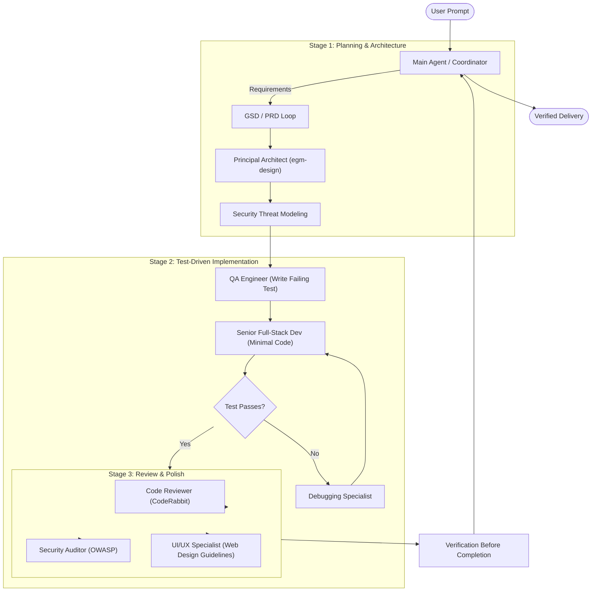

# Unified Multi-Agent Architecture & Specialist Matrix

**Objective:** Consolidate native Antigravity Swarm, EGM personas, and specialized subagents into a unified, high-precision engineering organization without redundant orchestrators.

---

## 1. Specialist Agents Matrix (13 Core Roles)

All 13 specialist roles requested by the user are formally defined, mapped to operational subagents, and bound to specific toolsets and completion criteria.

| Specialist Role | Bound Subagent / Persona | Primary Responsibilities | Tool Permissions | Completion Criteria |
| :--- | :--- | :--- | :--- | :--- |
| **1. Principal Architect** | `egm-design` & `ai-architect` | System architecture, scalability, infrastructure economics, unmitigated risk analysis, technology selection. | Read-only, web research, file inspection. | Actionable architecture spec or RFC with tradeoffs and risks identified. |
| **2. Research Specialist** | `research` subagent | Deep codebase surveying, documentation search, web intelligence gathering, library comparison. | Read-only sandbox, web search, doc tools. | Comprehensive findings document citing exact sources, versions, and APIs. |
| **3. Senior Full-Stack Developer** | `senior-fullstack-dev` *(Defined)* | End-to-end feature implementation, following Ponytail (smallest working diff), preserving error handling. | Full filesystem writes, CLI execution, MCP tools. | Clean implementation matching contracts, passes tests, zero extraneous code. |
| **4. Frontend Specialist** | `uiux-architect` | Modern UI engineering, React 19 composition, responsive layouts, micro-interactions, dark mode polish. | Workspace write, Shadcn MCP, UI tools. | Bespoke responsive UI conforming to Web Interface Guidelines. |
| **5. Backend Specialist** | `senior-fullstack-dev` / `vercel-services` | API endpoints, authentication guards, serverless functions, Queues, Workflows, data serialization. | Workspace write, CLI, Vercel/Firebase tools. | Hardened endpoints with Zod validation, error handling, and test coverage. |
| **6. UI/UX Specialist** | `uiux-architect` & `mobbin` | Aesthetic benchmarking against Linear/Stripe, typography hierarchy, Bento grids, luminous micro-borders. | Mobbin MCP, Figma MCP, 21st-dev MCP. | Verified design tokens, contrast compliance, and benchmark alignment. |
| **7. Database Specialist** | `database-specialist` *(Defined)* | Schema normalization (SQL/NoSQL), index optimization, BigQuery datasets, migration scripts. | Workspace write, BigQuery/Jupyter MCP. | Validated schema definitions, rollback-safe migrations, zero N+1 queries. |
| **8. Security Auditor** | `web-sec-auditor` & `user-journey-auditor` | OWASP Top 10 SAST audits, BOLA/BFLA checks, security threat modeling, secret scanning. | Static analyzers, endpoint inspection. | Security audit report with CWE/CVSS mapping and verified code fixes. |
| **9. QA Engineer** | `qa-engineer` *(Defined)* | Test-Driven Development (TDD), unit/integration/E2E test suites, edge case boundary coverage. | Test execution CLI, Playwright MCP. | Test suite executed; evidence log showing all passing assertions. |
| **10. Performance Engineer** | `performance-optimizer` | Core Web Vitals, bundle size reduction, memory leak isolation, CDN caching, database query plans. | Chrome DevTools MCP, profiling tools. | Quantified metric improvement (LCP, memory footprint, bundle reduction). |
| **11. DevOps Specialist** | `deployment-expert` | CI/CD pipelines, preview URLs, environment variables, Vercel/Cloudflare deployments, build optimization. | Vercel CLI, Cloudflare deploy skill. | Successful deployment build verified live via HTTP status checks. |
| **12. Documentation Specialist** | `egm-style` & `egm-structural` | Clear, concise documentation, API references, READMEs, changelogs, and Architecture Decision Records (ADRs). | Markdown formatting, docx/pdf skills. | Structured documentation with zero AI fluff, verified code examples. |
| **13. Debugging Specialist** | `debugging-specialist` *(Defined)* | Systematic hypothesis-driven root-cause debugging, stack trace analysis, memory heap inspection. | Runtime CLI, Chrome DevTools MCP. | Minimal reproducing test case passing after root-cause fix in shared code. |

---

## 2. Delegation & Communication Protocol

### Delegation Rules:
1. **Evidence Before Assertions:** No subagent may report a task "done" without including the terminal command run and its stdout/stderr confirming success.
2. **Strict Scope Bounding:** Subagents must touch only files directly within their delegated slice. Unrelated refactoring is strictly prohibited.
3. **Least Privilege:** Research and audit personas operate in read-only mode. Only implementation and devops agents hold write permissions.
4. **Parallel Execution Discipline:** Parallel subagents (`invoke_subagent` or `swarm`) are spawned **only** for strictly independent tasks with no shared state or sequential dependency.
