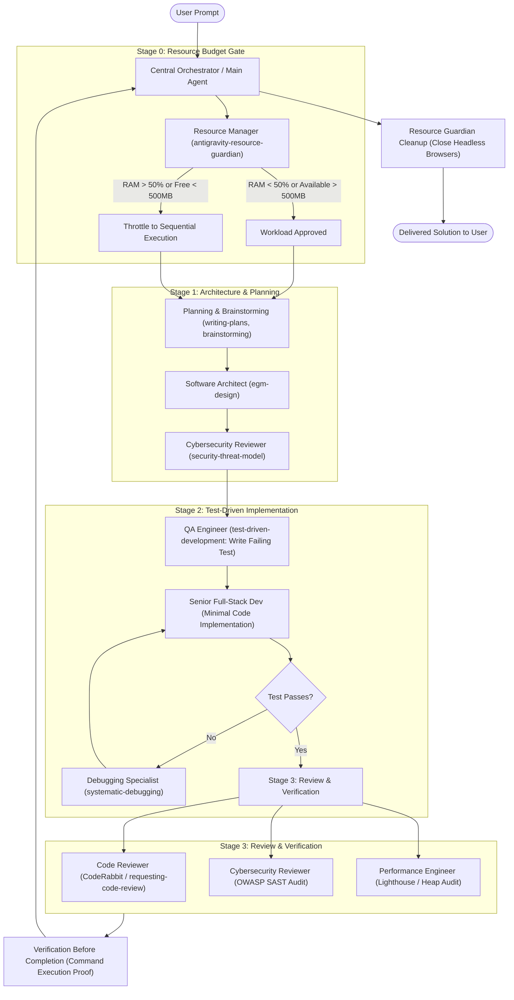

# Unified Multi-Agent Architecture & Specialist Matrix (Phase 2)

**Objective:** Consolidate Antigravity's native coordination mechanisms into a high-precision, 15-role specialist engineering organization with strict resource budgeting.

---

## 1. Specialist Agents Matrix (15 Core Roles)

All 15 specialist roles are formally defined, mapped to operational subagents or personas, and governed by resource limits and verification rules.

| Specialist Role | Registered Subagent / Persona | Primary Focus & Domain | Tool Access | Resource Budget | Verification Standard |
| :--- | :--- | :--- | :--- | :--- | :--- |
| **1. Software Architect** | `egm-design` & `ai-architect` | High-level system architecture, scalability, technology stack boundaries, and trade-off analysis. | Read-only, Web search, Doc tools | $\le 100\text{ MB}$ | Architectural RFC or ADR citing concrete trade-offs and failure modes. |
| **2. Senior Full-Stack Developer** | `senior-fullstack-dev` | Feature implementation following Ponytail (smallest working diff), preserving error boundaries. | Full Filesystem, CLI, MCP tools | $\le 250\text{ MB}$ | Passes all test suites; zero extraneous wrappers or unrequested dependencies. |
| **3. Frontend Developer** | `uiux-architect` | Modern frontend engineering, React 19 composition, responsive layouts, micro-interactions, dark mode. | Workspace writes, Shadcn MCP, UI tools | $\le 200\text{ MB}$ | Responsive layout tested across breakpoints; Web Interface Guidelines compliant. |
| **4. Backend Developer** | `senior-fullstack-dev` / `vercel-services` | REST/GraphQL APIs, auth middleware, edge functions, queuing, background workflows, data serialization. | Workspace writes, CLI, Serverless tools | $\le 200\text{ MB}$ | Endpoints hardened with Zod validation, sanitized errors, and contract tests. |
| **5. Database Specialist** | `database-specialist` | Normalized SQL/NoSQL schemas, index optimization, query plans, BigQuery datasets, safe migrations. | Workspace writes, BigQuery/Notebook MCP | $\le 150\text{ MB}$ | Validated schema definitions; rollback-tested migration scripts; zero N+1 queries. |
| **6. Cybersecurity Reviewer** | `cybersecurity-reviewer` & `web-sec-auditor` | STRIDE threat modeling, OWASP Top 10 SAST audits, BOLA/BFLA guards, dependency vulnerability scans. | Static code analyzers, Endpoint inspectors| $\le 100\text{ MB}$ | Comprehensive security audit report mapping findings to CWE/CVSS with verified fixes. |
| **7. QA Engineer** | `qa-engineer` | Test-Driven Development (TDD) enforcement, unit/integration test suites, edge case boundary coverage. | Test execution CLI, Test frameworks | $\le 200\text{ MB}$ | Failing test written first, verified failing, then verified passing with terminal log. |
| **8. Test Automation Engineer** | `test-automation-engineer` | Resilient Playwright E2E browser automation, API contract tests, visual regression, CI test pipelines. | Playwright MCP, Headless browser | $\le 300\text{ MB}$ (Gated) | E2E suite executed cleanly; browser context closed immediately after test run. |
| **9. Performance Engineer** | `performance-optimizer` | Core Web Vitals (LCP, CLS, INP), bundle size reduction, memory leak isolation, CDN caching strategies. | Chrome DevTools MCP, Profiling tools | $\le 250\text{ MB}$ | Quantified performance metrics (LCP improvement, heap snapshot reduction). |
| **10. DevOps Engineer** | `deployment-expert` | CI/CD pipelines, preview URLs, environment variables, Vercel/Cloudflare deployments, build optimization. | Vercel CLI, Cloudflare deploy skill | $\le 200\text{ MB}$ | Production/preview deployment live and verified via HTTP 200 health check. |
| **11. Documentation Specialist** | `egm-style` & `egm-structural` | Concise technical documentation, API references, READMEs, changelogs, and Architecture Decision Records. | Markdown formatting, docx/pdf skills | $\le 50\text{ MB}$ | Structured docs with zero AI fluff; all code samples verified against codebase. |
| **12. Research Specialist** | `research` subagent | Deep codebase surveying, documentation search, web intelligence gathering, library comparison. | Read-only sandbox, web search | $\le 50\text{ MB}$ | Structured findings document citing exact documentation URLs, versions, and APIs. |
| **13. Debugging Specialist** | `debugging-specialist` | Hypothesis-driven root-cause debugging, stack trace analysis, memory heap inspection. | Runtime CLI, Chrome DevTools MCP | $\le 150\text{ MB}$ | Minimal reproducing test case isolated; root-cause fix verified in shared primitives. |
| **14. UI/UX Specialist** | `uiux-architect` & `mobbin` | Aesthetic benchmarking against Linear/Stripe, typography hierarchy, Bento grids, luminous micro-borders. | Mobbin MCP, Figma MCP, 21st-dev MCP | $\le 150\text{ MB}$ | Verified design tokens, contrast compliance, and benchmark alignment. |
| **15. Resource Manager** | `resource-manager` | Enforces `antigravity-resource-guardian`, monitors RAM/SSD/CPU budgets, cancels runaway jobs, gates heavy tasks. | PowerShell execution, CIM queries | $\le 25\text{ MB}$ | Host RAM kept within budget; pre-task checks executed before heavy workloads. |

---

## 2. Central Orchestration & Execution Protocol

### Delegation Rules:
1. **Pre-Flight Gating:** The Central Orchestrator must query the `resource-manager` before spawning browser automation or multi-agent swarms.
2. **Evidence Before Assertions:** No specialist agent may report a task "done" without including the terminal command run and its stdout/stderr confirming success.
3. **Strict Scope Bounding:** Specialists must touch only files directly within their delegated slice.
4. **Immediate Teardown:** Headless browser instances and temporary build workers must be terminated immediately upon task completion.
