# Roo Code Autonomous Agent System & Modes

The **Roo Code** skill equips Antigravity with complete compatibility and operational mastery over the Roo Code (formerly Roo Cline) autonomous agent ecosystem. It standardizes custom modes (`.roomodes`), role boundaries, and multi-agent phase delegation.

---

## 1. Core Operating Modes (`.roomodes`)

Roo Code organizes development into five distinct operational modes, each with strictly scoped tool permissions:

| Mode Slug | Role Name | Allowed Tools | Primary Purpose | Completion Standard |
| :--- | :--- | :--- | :--- | :--- |
| **`architect`** | System Architect | `read_file`, `search`, `ask_question` | Requirements gathering, system architecture, tech stack selection, risk analysis. **Zero code edits.** | Comprehensive architectural plan or RFC approved before code is written. |
| **`code`** | Full-Stack Developer | `read_file`, `edit_file`, `write_file`, `run_command` | End-to-end implementation, atomic code changes, bug fixing, and refactoring. | Code implemented to spec, adheres to project style, passes linter. |
| **`ask`** | Technical Explorer | `read_file`, `search_web`, `doc_query` | Interactive exploration, architectural questions, documentation lookups. | Direct, grounded explanation with source citations. |
| **`debug`** | Debugging Specialist | `read_file`, `edit_file`, `run_command`, DevTools | Hypothesis-driven root-cause isolation, stack trace analysis, memory leak tracing. | Minimal reproducing test case passing after shared root-cause fix. |
| **`test`** | QA & Test Engineer | `read_file`, `write_file`, `run_command`, Playwright | Test-Driven Development (TDD), unit/integration test suites, E2E browser tests. | All test assertions executed; terminal proof logged. |

---

## 2. Standard `.roomodes` Configuration Template

To initialize or configure Roo Code in any workspace, generate `.roomodes` at the project root:

```json
{
  "customModes": [
    {
      "slug": "architect",
      "name": "System Architect",
      "roleDefinition": "You are a Principal Software Architect. Focus exclusively on requirements discovery, system topology, data structures, and trade-offs. Never edit code or write implementation files directly.",
      "groups": ["read", "browser"]
    },
    {
      "slug": "code",
      "name": "Software Engineer",
      "roleDefinition": "You are a Senior Full-Stack Engineer. Implement clean, robust, pragmatic code matching the architectural specifications. Follow test-driven engineering and minimal diff principles.",
      "groups": ["read", "edit", "command", "mcp"]
    },
    {
      "slug": "debug",
      "name": "Debugging Specialist",
      "roleDefinition": "You are a Diagnostic Engineer. Conduct systematic, hypothesis-driven root-cause analysis for any error or crash before altering code. Fix root causes in shared primitives.",
      "groups": ["read", "edit", "command", "browser", "mcp"]
    },
    {
      "slug": "test",
      "name": "QA & Test Engineer",
      "roleDefinition": "You are a QA Test Engineer. Enforce Test-Driven Development (TDD), author Playwright E2E suites and unit tests, and verify all test assertions with terminal proof.",
      "groups": ["read", "edit", "command", "browser", "mcp"]
    },
    {
      "slug": "security",
      "name": "Cybersecurity Reviewer",
      "roleDefinition": "You are an Application Security Auditor. Perform STRIDE threat modeling, OWASP Top 10 code audits, dependency vulnerability checks, and security boundary reviews.",
      "groups": ["read", "command", "mcp"]
    }
  ]
}
```

---

## 3. Workflow Integration Matrix: GSD + Ralph + Roo Code + CodeRabbit

This environment unifies the four leading autonomous agent workflows into a single cohesive pipeline:

```mermaid
flowchart LR
    subgraph Spec ["1. Specification & PRD"]
        Ralph["Ralph Loop (prd, ralph)"] --> GSDPlan["GSD Phase Planning (gsd-plan)"]
    end

    subgraph Architecture ["2. Mode: Architect"]
        GSDPlan --> RooArch["Roo Code: Architect Mode (.roomodes)"]
    end

    subgraph Execution ["3. Mode: Code & Test"]
        RooArch --> RooTest["Roo Code: Test Mode (TDD first)"]
        RooTest --> RooCode["Roo Code: Code Mode (Minimal diff)"]
        RooCode --> GSDExec["GSD Execution (gsd-execute)"]
    end

    subgraph Verification ["4. Mode: Review & Audit"]
        GSDExec --> CR["CodeRabbit (code-review, autofix)"]
        CR --> GSDVerify["GSD Verification (gsd-verify)"]
    end
```



---

## 4. Operational Runbook

1. **Phase 1 — Discovery & Planning:**
   - Use `prd` to generate user stories and acceptance criteria.
   - Use `gsd-plan` to break stories into atomic tasks stored in `.planning/`.
   - Operate under `architect` mode rules (read-only, zero blind edits).
2. **Phase 2 — Test-Driven Implementation:**
   - Switch to `test` mode: write failing tests that assert the acceptance criteria.
   - Switch to `code` mode: write the minimal viable code to satisfy the tests.
   - Execute `gsd-execute` to commit atomic checkpoints.
3. **Phase 3 — Review & Autofix:**
   - Invoke `code-review` via CodeRabbit CLI to detect potential regressions or security flaws.
   - If findings exist, execute `autofix` to prepare approved diffs.
   - Run `gsd-verify` to confirm full acceptance criteria and update `.planning/STATE.md`.
